# CineFuze

**A media center for Android TV boxes with Dolby Vision FEL and 3D Blu-ray (MVC)** – built for the Dune HD and
R_volution players with an Amlogic S928X and the Dune HD players with an Amlogic S905X4, on its own libVLC build that
plays the full enhancement layer of Dolby Vision profile 7 (composited on the GPU of the S928X, by the Dolby Vision core
of the S905X4) and 3D Blu-ray (MVC) in frame packing.

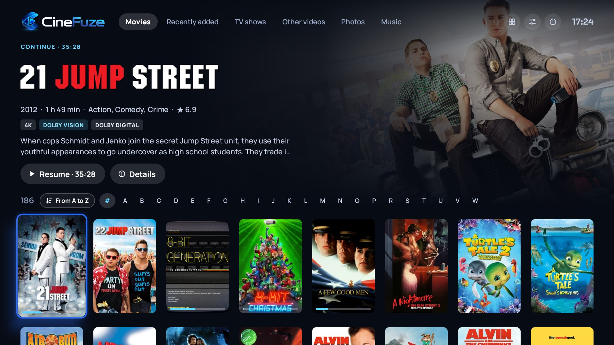

> **Preview.** CineFuze is in beta. It runs on every S928X player of Dune HD and R_volution; it is tested on the
> Dune HD Pro 8K Plus, Pro One 8K Plus and the R_volution PlayerPro 8K. Dolby Vision FEL on the S905X4 is new (since
> 0.8.0-beta2) and tested on the Dune HD Pro Vision 4K (firmware r24). This repository presents the app and hosts its
> APK under [Releases](https://github.com/djnice/cinefuze/releases).

## Features

### Library
- Sources: SMB shares (NAS, PC) and the box's own drives (USB, internal HDD); network browsing (NetBIOS, mDNS) that
  reuses the logins the player's firmware has saved.
- Movies, TV shows, other videos, photos and music, each with its own wall.
- Metadata from TMDB in 17 languages (titles, plots, posters, backdrops, title logos), disc art from fanart.tv.
- Media info read from the files themselves: resolution, HDR10 / HDR10+ / HLG, Dolby Vision profile and FEL / MEL,
  MaxCLL / MaxFALL and the RPU's L6, Atmos / DTS:X / DTS-HD MA audio, subtitles, chapters.
- Watched marks, resume points and favourite scenes shared between boxes through the NAS.

### Browsing
- Four wall layouts: Highlight (the selected title large), Full wall, Large posters, and 2.39:1 variants for scope
  screens.
- Sort and filter chips: A–Z, rating, runtime, date added, year, genre, folder; page jumps with P+ / P-.
- Detail page: backdrop, title logo, director, a technical card, cast with face-centred photos and biographies,
  extras (TMDB videos, soundtrack), and the trailer in a soft-edged window.
- TV shows: episode detection from folders and file names, season posters, episode stills, a countdown to the next
  episode, Blu-ray discs whose chapters are episodes.

### Playback
- **Dolby Vision profile 7 FEL with its full enhancement layer**, composited on the GPU on the S928X and by the
  SoC's own Dolby Vision core on the S905X4 (MEL is converted to profile 8.1); dual-track (DTDL) MP4 and Blu-ray m2ts.
- **3D Blu-ray (MVC)** in frame packing for 3D projectors and TVs (MKV / MK3D, m2ts, SSIF).
- **Audio as an HDMI bitstream:** Dolby TrueHD / Atmos, DTS-HD MA / DTS:X, E-AC-3, AC-3, DTS – per format, only what
  the receiver takes.
- Automatic refresh-rate switching, seek previews (made in the background), chapters, audio / subtitle panels, an
  INFO panel with the live Dolby Vision levels, and a FEL demo mode on the S928X (split screen: FEL vs. the base
  layer).
- Blu-ray folders and ISO images open with the menus of the player's own Blu-ray player (HDMV and BD-J); when the
  main movie starts, CineFuze takes over.
- Favourite scenes: mark the start and end while a film plays; scene cards and a timeline on the detail page.

### Photos and music
- Photo wall with dates and places (EXIF), a full-screen viewer with a map of where the photo was taken.
- A live slideshow rendered on the GPU in five styles – Polaroid, Photo table, Gallery wall, Collage zoom, Memories – with music
  if you like.
- Music: album wall with covers and disc art (MusicBrainz, Cover Art Archive, fanart.tv), an album page with a
  spinning record, and a player with three visualizers; FLAC, APE and the usual formats.

### On the player's firmware
- Firmware without the Dolby Vision FEL module (Dune HD r22 / r24): the kernel module is installed with the first
  FEL film (it asks once if root access is off, and switches it back off).
- Firmware with the module (Dune HD r25): the firmware brings it itself; CineFuze uses it and installs nothing.
  Newer modules come as a Dune HD plugin from [vlc-fel-android](https://github.com/djnice/vlc-fel-android/releases).
- R_volution players are handled the same way.
- S905X4 (Dune HD r24; r22 not tested): CineFuze installs its S905X4 kernel module with the first FEL film, the same
  way. 3D MVC is not tested there yet.

## Screenshots

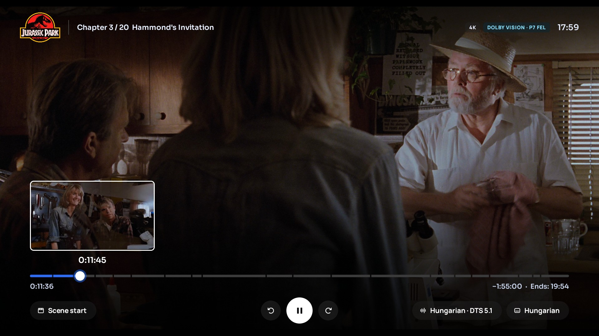
Playback: chapters, Dolby Vision P7 FEL, the seek preview while scrubbing. (The box's screen capture leaves out
the video plane; the film frame behind the controls is taken from the same file at the same time.)

| | |
|---|---|
| 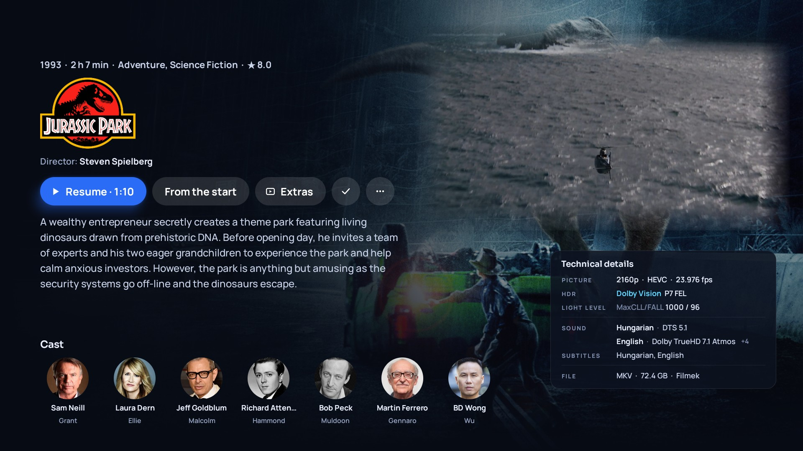 Detail page: title logo, the trailer in a soft-edged window, the technical card (Dolby Vision P7 FEL) | 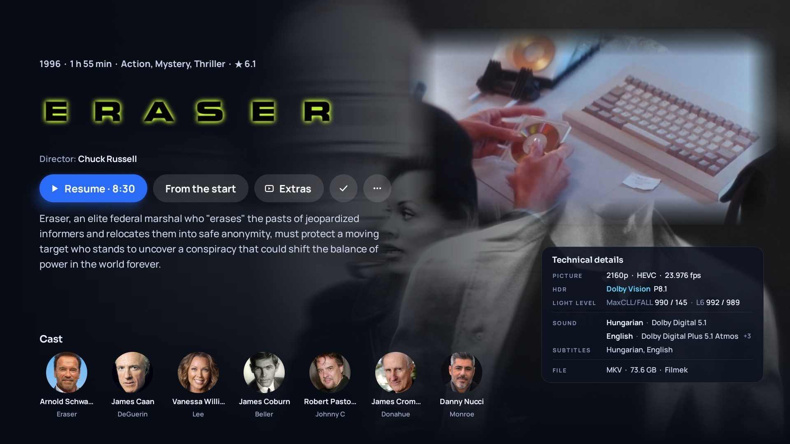 MaxCLL / MaxFALL and the RPU's L6, the audio tracks with Atmos |
| 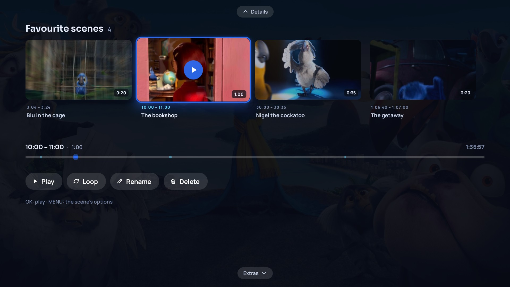 Favourite scenes: cards, the film's timeline, play / loop | 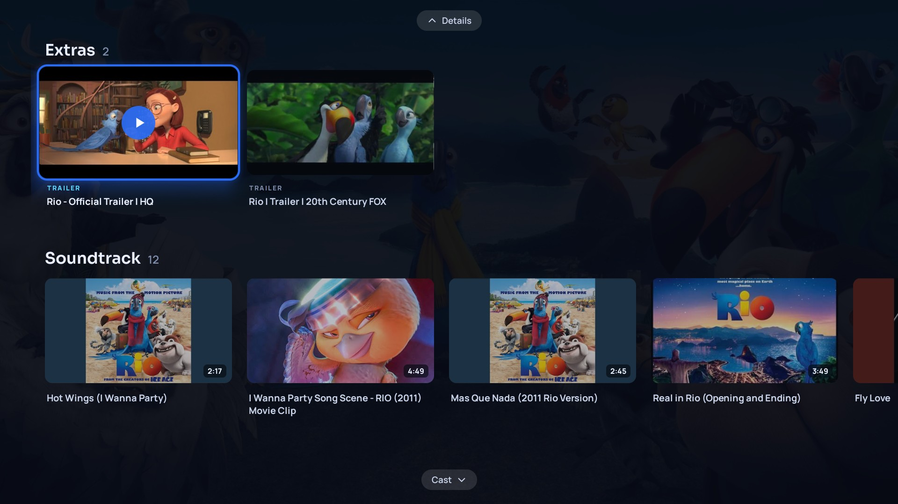 Extras: trailers and the soundtrack |
| 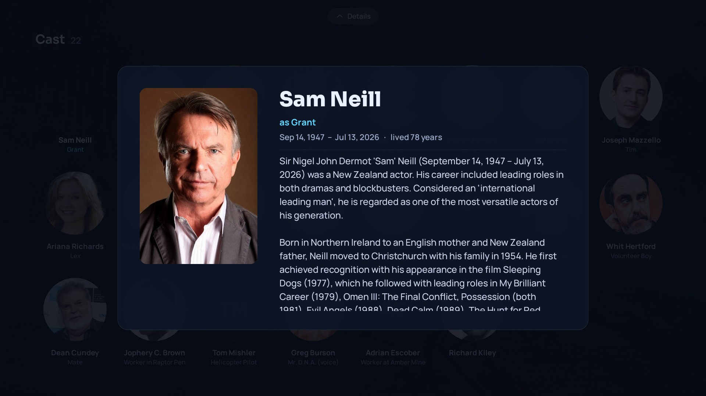 Cast biography | 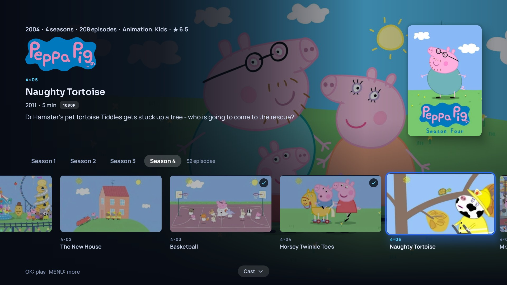 TV show: seasons, episode stills, watched marks |
| 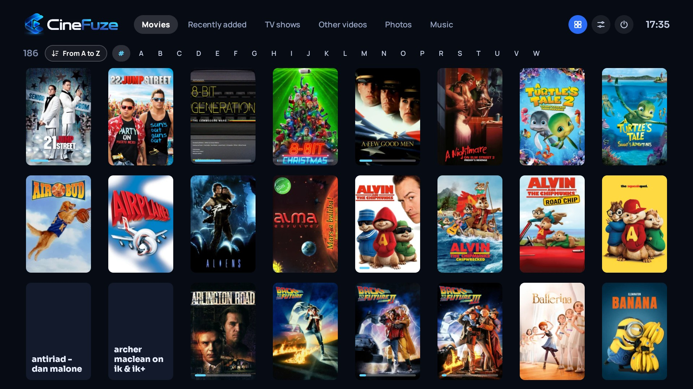 Full wall layout | 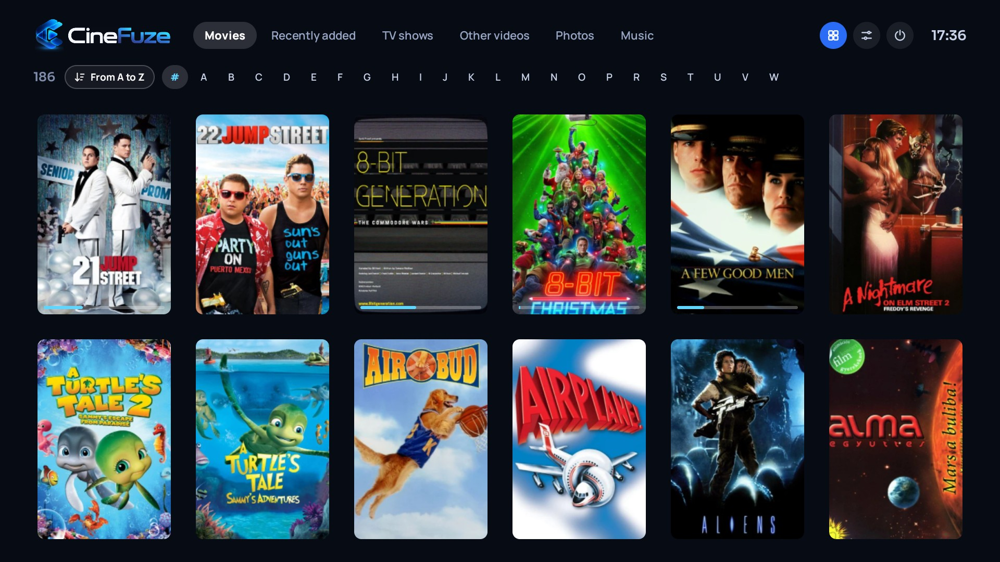 Large posters layout |
| 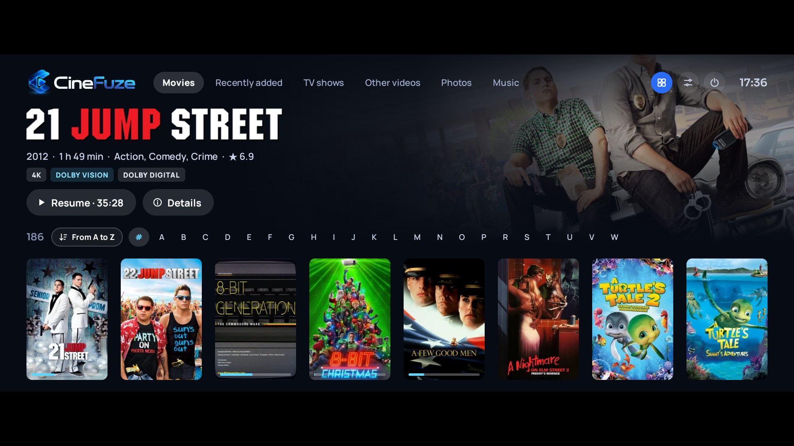 Highlight layout for 2.39:1 screens | 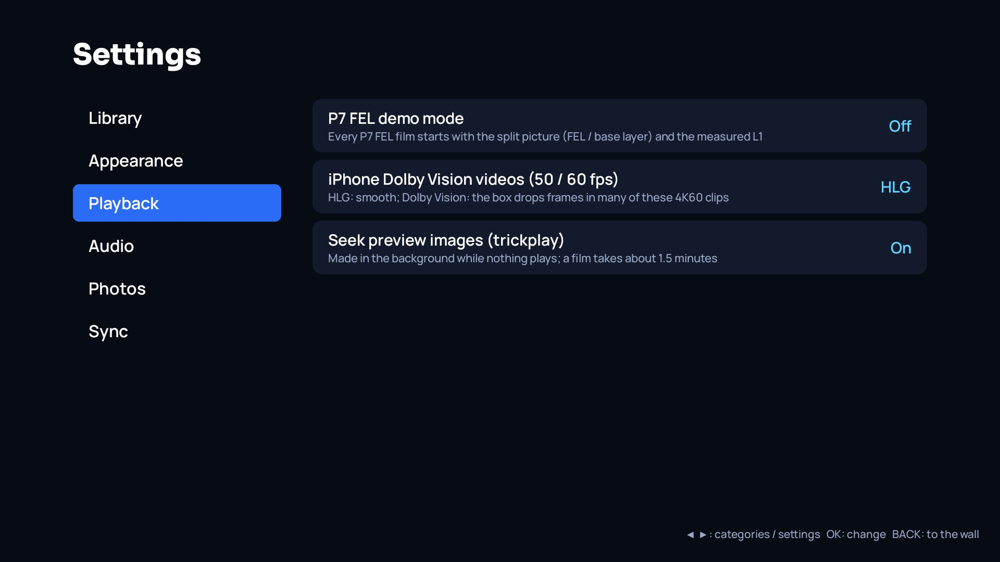 Settings |
| 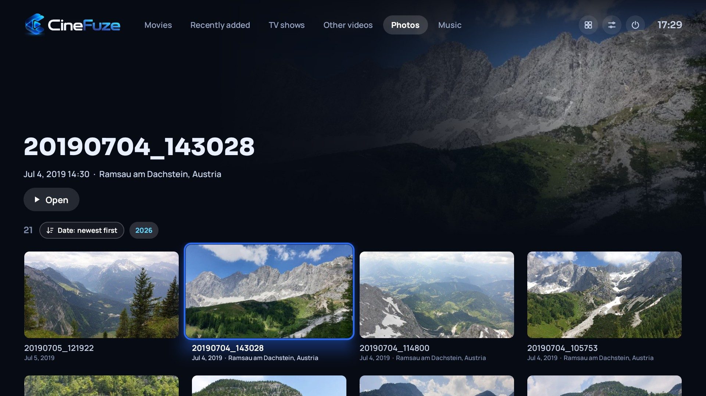 Photo wall with dates and places | 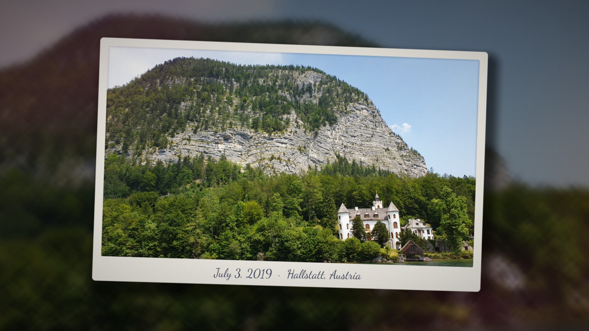 Slideshow, Polaroid style |
| 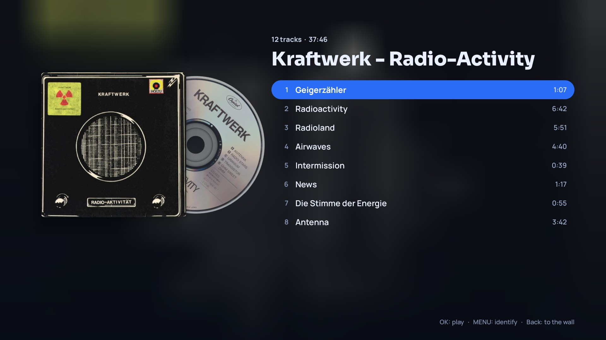 Album page with cover and disc art | 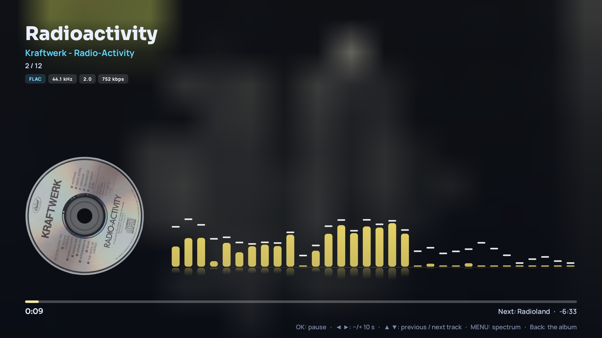 Music player with the spectrum visualizer |

## Requirements
- A Dune HD or R_volution player with an Amlogic S928X, or a Dune HD player with an Amlogic S905X4.
- Android 11, 32-bit (armeabi-v7a) userspace.
- Media on a NAS / PC (SMB) or a drive connected to the box.

## Download
The APK is under [Releases](https://github.com/djnice/cinefuze/releases). Install it like any other APK on the box
(from a USB stick or a network share); a newer APK installs over the old one and keeps the library.

## Related projects
- [vlc-fel-android](https://github.com/djnice/vlc-fel-android) – the libVLC patches, the `dvfel` kernel module and
  `libdvfelplay` that CineFuze plays Dolby Vision FEL with, the 3D MVC decoding (GPL), and the Dune HD plugin.

## Credits
This product uses the TMDB API but is not endorsed or certified by TMDB. Disc art from fanart.tv, music metadata
from MusicBrainz and the Cover Art Archive, maps © OpenStreetMap contributors. Video playback by VLC (libVLC).
Film artwork in the screenshots belongs to its owners.

Dolby, Dolby Vision, Dolby Atmos and Dolby TrueHD are trademarks of Dolby Laboratories; DTS, DTS-HD and DTS:X are
trademarks of DTS, Inc.; Dune HD and R_volution are trademarks of their owners. CineFuze is not affiliated with any
of them.
